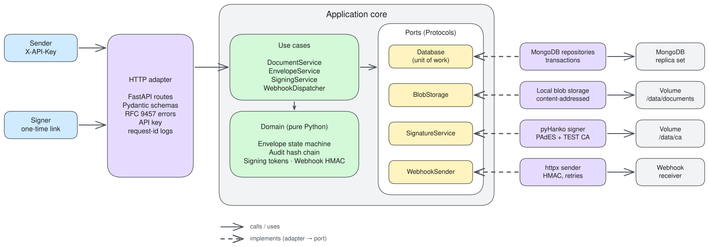
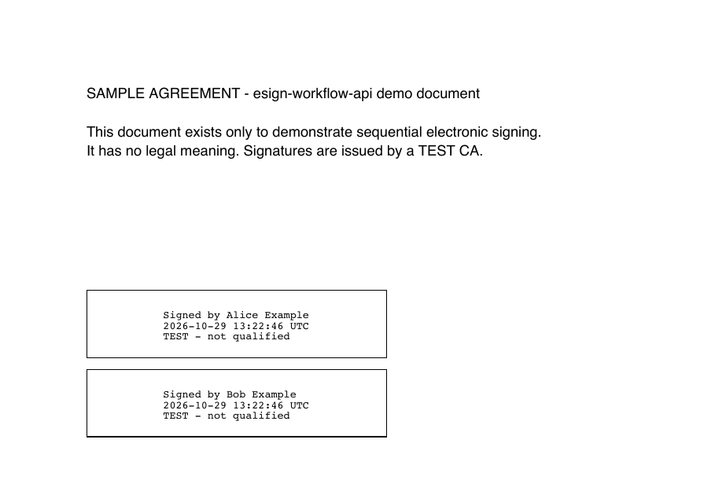
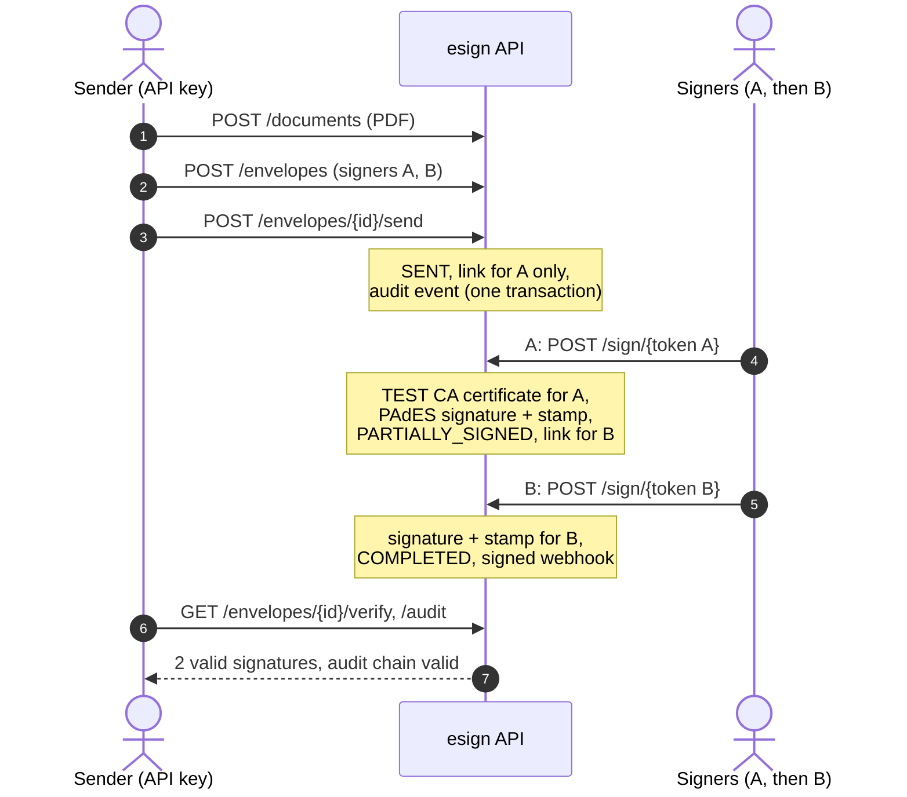

# esign-workflow-api

Sequential document signing: upload a PDF, add signers, collect one real PAdES signature each, with a tamper-evident audit trail.

[](https://github.com/daniellaera/esign-workflow-api/actions/workflows/ci.yml)

[](LICENSE)

## Live demo

**[esign.daniellaera.com/docs](https://esign.daniellaera.com/docs)**: run the whole flow in Swagger. Click **Authorize** and use the public demo key `esign-demo-public-key`.

- All data is deleted after 24 h. **Do not upload real or personal documents.** Signatures come from a test CA.
- Limits: 2 MB per PDF, 5 signers per envelope, 120 requests/min and 30 new envelopes/hour per IP.
- Demo only: `GET /envelopes/{id}/signing-link` returns the current signer's link, so no inbox is needed. No webhooks are sent.



FastAPI · Pydantic v2 · MongoDB (PyMongo async, transactions) · pyHanko · Docker. More diagrams: [ARCHITECTURE.md](docs/ARCHITECTURE.md).

## Try it in 2 minutes

Needs Docker, [uv](https://docs.astral.sh/uv/) and make.

```bash
make up demo
```

This starts the API and MongoDB, then has two signers sign `samples/contract.pdf`:

```text
==> Uploading samples/contract.pdf
==> Creating envelope with two sequential signers
    envelope f24d9350284a4627aef4b0d5febd3523 status=DRAFT
==> Sending envelope
==> Alice Example opens the link from the outbox and signs
    envelope status=PARTIALLY_SIGNED
==> Bob Example opens the link from the outbox and signs
    envelope status=COMPLETED
==> Verifying signatures
    Signature1: Alice Example intact=True valid=True chain_valid=True
    Signature2: Bob Example intact=True valid=True chain_valid=True
==> Checking the audit hash chain
    9 events, chain_valid=True
==> Independent check with the pyHanko CLI
Signature1:5a17d3e0…:VALID
Signature2:76662cd7…:VALID
```

The result, `out/signed.pdf`, with one visible stamp per signer:



Interactive API docs: http://localhost:8000/docs (API key `dev-api-key-change-me`). Tests: `make test` (108 tests, 97% coverage). Lint and types: `make lint`.

## Signing flow



## API overview

| Method | Path | Purpose |
|---|---|---|
| `POST` | `/documents` | Upload a PDF (max 10 MB) |
| `POST` | `/envelopes` | Create an envelope; supports `Idempotency-Key` |
| `GET` | `/envelopes/{id}` | Envelope and signer statuses |
| `POST` | `/envelopes/{id}/send` | Invite the first signer |
| `GET` | `/envelopes/{id}/document` | Current signed PDF |
| `GET` | `/envelopes/{id}/verify` | Check every signature and the document hash |
| `GET` | `/envelopes/{id}/audit` | Audit events and chain verification |
| `GET` | `/envelopes/{id}/webhook-deliveries` | Webhook attempts |
| `GET` | `/sign/{token}` | What the signer is asked to sign |
| `GET` | `/sign/{token}/document` | The PDF to sign |
| `POST` | `/sign/{token}` | Sign |
| `POST` | `/sign/{token}/decline` | Decline |
| `GET` | `/envelopes/{id}/signing-link` | Current signer's link (live demo only) |
| `GET` | `/trust/test-ca.pem` | Test CA certificate |
| `GET` | `/health/live`, `/health/ready` | Probes |

Management endpoints need `X-API-Key`; signing endpoints need only the token. Errors are RFC 9457 problem details.

## Design decisions

- **Ports and adapters, kept light.** Pure domain, Protocol ports, one composition root. [ADR 0001](docs/adr/0001-lightweight-ports-and-adapters.md)
- **MongoDB transactions.** Envelope, audit, outbox and webhook record commit together; optimistic locking on top. [ADR 0002](docs/adr/0002-mongodb-transactions.md)
- **Signing links.** One signer at a time, only the token hash stored, one-time, 72 h. [ADR 0003](docs/adr/0003-signing-links.md)
- **Test CA.** Short-lived certificate per signer, as remote signing does; validated at signing time. [ADR 0004](docs/adr/0004-test-ca-and-signatures.md)
- **Audit hash chain.** Each event hashes its predecessor; a unique index prevents forks. [ADR 0007](docs/adr/0007-audit-hash-chain.md)
- **Webhooks.** Recorded in the transaction, sent after commit, every attempt stored. [ADR 0006](docs/adr/0006-webhook-delivery.md)

All ADRs: [docs/adr](docs/adr/README.md).

## Not a qualified signature

eIDAS (EU) and ZertES (Switzerland) define three levels: a **simple** signature (SES) is any electronic mark, such as a click; an **advanced** signature (AES) identifies the signer, uses means under their sole control and detects later changes; a **qualified** signature (QES) is an AES based on a qualified certificate and created on a qualified device. Only a QES equals a handwritten signature (in Switzerland together with a qualified timestamp, Art. 14 para. 2bis CO).

This POC creates real PAdES signatures from a **test CA**. They are not qualified, and not advanced either: signers are not identified and the server holds their keys. A real QES needs:

- a qualified trust service provider, recognised under ZertES or listed under eIDAS;
- identity verification of each signer;
- keys in a qualified signature creation device (an HSM, for remote signing) with strong signer authentication;
- qualified timestamps and long-term validation data.

## How this was built

Developed with Claude Code, reviewed and owned by Daniel Laera.
