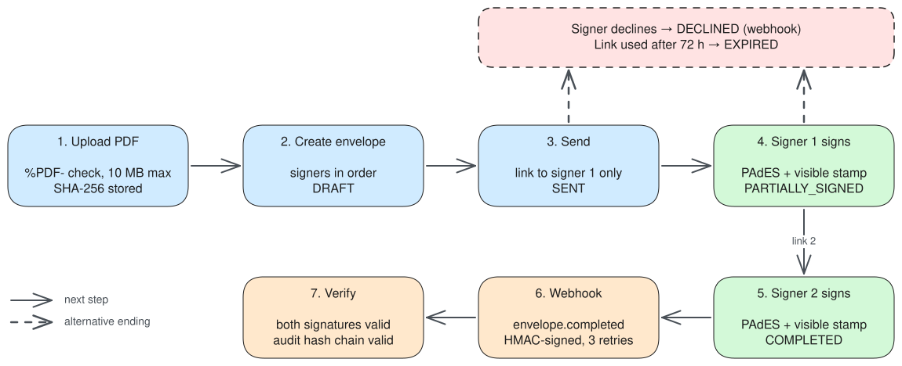
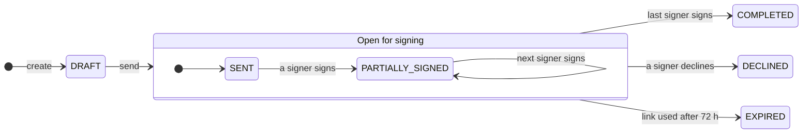
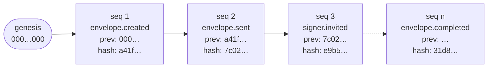
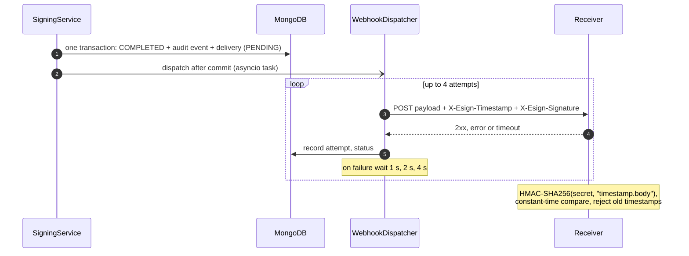

# Architecture

## Components (ports and adapters)

## Signing flow

## Envelope state machine

Any other transition is rejected with `409 invalid-state-transition`.

## Audit hash chain

`hash = SHA-256(canonical JSON of the event + previous_hash)`. Editing, deleting or reordering any event breaks every link after it.

## Webhook delivery

## In short

- **Domain** (`esign.domain`): pure Python. State machine, tokens, audit chain, HMAC. No framework imports.
- **Application** (`esign.application`): one service per use case. Talks to the outside only through `Protocol` ports.
- **Adapters** (`esign.adapters`): FastAPI in front; MongoDB, local storage, pyHanko and httpx behind.
- **Composition root** (`esign.container`): the only module that knows concrete classes.
- **Transactions**: every state change writes envelope, audit event, outbox and webhook record atomically (MongoDB replica set).
- **Concurrency**: optimistic locking on the envelope `version`; a unique index keeps the audit chain linear.
- **Signing** runs before the transaction. Each revision is an immutable blob keyed by its SHA-256.
- **Signatures**: PAdES, incremental update, visible stamp, short-lived certificate from the TEST CA.
- **Links**: only the current signer has one. Only its SHA-256 is stored. One-time, 72 h.
- **Webhooks**: recorded in the transaction, delivered after commit, every attempt stored.
- **Errors**: RFC 9457 problem details from one mapping table. **Logs**: JSON, request id, no personal data, no tokens.

Details and trade-offs: [ADRs](adr/README.md).
